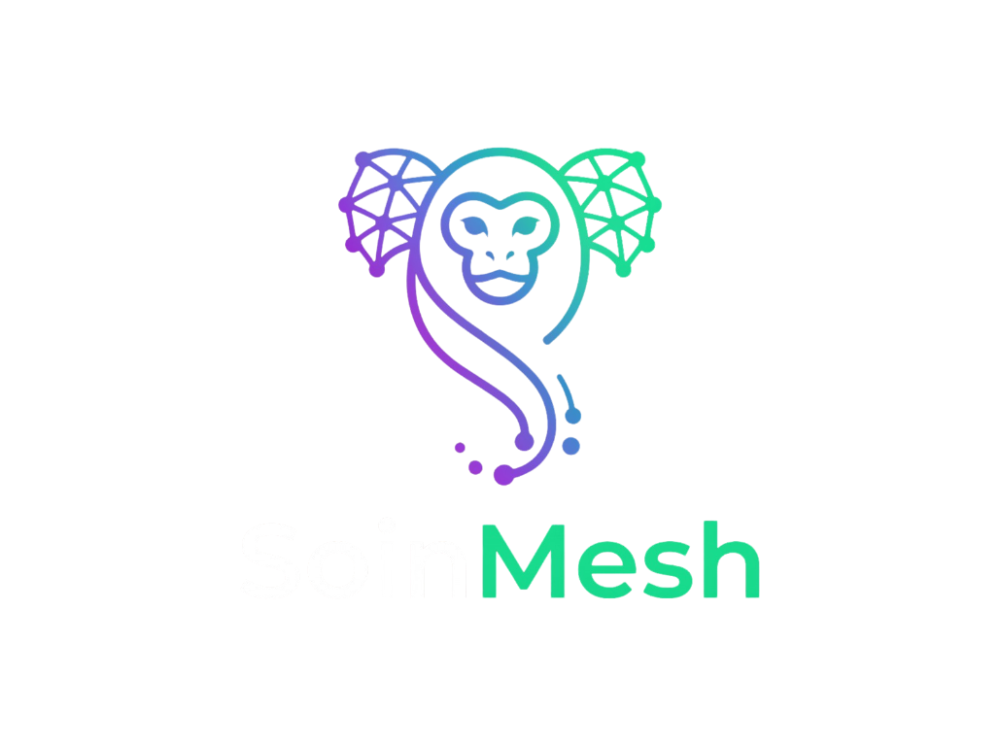

<p align="center">
  
</p>

# SoinMesh AI - A organização facilitada.

Este repositório contém a interface frontend, o banco PostgreSQL, a
infraestrutura Docker e os workflows n8n do projeto Soin - Busca Inteligente.

## Estrutura do projeto

```text
├── frontend/
│   ├── assets/
│   │   ├── css/
│   │   │   └── styles.css
│   │   ├── js/
│   │   │   └── app.js
│   │   └── index.html
├── database/
│   ├── 00-create-postgres-role.sql
│   └── 01-hackathon.sql
├── infrastructure/
│   ├── pgadmin-servers.json
│   ├── postgres-compose.yaml
│   └── postgres.env.example
├── n8n/
│   ├── workflows/
│   │   ├── dados-reais-dashboard.json
│   │   └── InHire AI - Motor de Alocação Completo.json
│   ├── compose.yml
│   └── .env.example
├── .gitignore
└── README.md
```

## Pré-requisitos

- Docker e Docker Compose
- Git
- Navegador web

## Passo 1: Clonar o repositório

```bash
git clone https://github.com/anajuliazip/Os_soin_Hackathon_Vintglobal.git
cd Os_soin_Hackathon_Vintglobal
```

## Passo 2: Configurar o PostgreSQL

Crie o arquivo de ambiente a partir do exemplo:

```bash
cd infrastructure
cp postgres.env.example .env
```

Edite o `.env` e defina uma senha local segura:

```env
POSTGRES_PASSWORD=sua_senha_segura
```

Suba o PostgreSQL e o pgAdmin:

```bash
docker compose -f postgres-compose.yaml up -d
```

O banco fica disponível em `localhost:5432` e o pgAdmin em
`http://localhost:5050`.

O banco é inicializado automaticamente pelos arquivos em `database/` na
primeira criação do volume.

Para recriar o banco do zero, apagando os dados locais:

```bash
docker compose -f postgres-compose.yaml down -v
docker compose -f postgres-compose.yaml up -d
```

## Passo 3: Configurar o n8n

Em outro terminal:

```bash
cd n8n
cp .env.example .env
docker compose up -d
```

Acesse o n8n em:

```text
http://localhost:5678
```

No n8n, configure a credencial **Postgres account** com:

- **Host:** `hackathon-postgres`
- **Database:** `hackathon`
- **User:** `hackathon`
- **Password:** a mesma definida no ambiente do PostgreSQL
- **Port:** `5432`

Se os containers estiverem em redes Docker diferentes, conecte o container do
n8n à rede do PostgreSQL ou use o endereço acessível entre os containers.

### Ativar o CORS

Para permitir que o frontend acesse os webhooks do n8n, o CORS precisa estar
configurado para a origem em que o frontend está sendo executado. No arquivo
`n8n/.env`, confirme:

```env
N8N_CORS_ALLOW_ORIGIN=http://localhost:8088
```

Se utilizar outra porta ou o Live Server do VS Code, substitua o valor pela
origem correspondente. Depois de alterar o arquivo, reinicie o n8n:

```bash
cd n8n
docker compose up -d --force-recreate n8n
```

## Passo 4: Importar os workflows

No n8n, use **Workflows > Import from File** e importe os arquivos da pasta
`n8n/workflows/`:

- `InHire AI - Motor de Alocação Completo.json`
- `dados-reais-dashboard.json`

Depois:

1. Confirme a credencial PostgreSQL nos nós de banco.
2. Ative os workflows.
3. Use o modo **Production**, não apenas o modo de teste.

O workflow de dados reais disponibiliza:

```text
GET http://localhost:5678/webhook/dashboard-dados
GET http://localhost:5678/webhook/demandas-pessoas
```

## Passo 5: Configurar o Ollama

O workflow principal utiliza o modelo Qwen. Com o container do Ollama em
execução, baixe o modelo:

```bash
docker exec -it ollama ollama pull qwen2.5:3b
```

## Passo 6: Abrir o frontend

Em outro terminal, na raiz do projeto:

```bash
cd frontend
python -m http.server 8088
```

Abra:

```text
http://localhost:8088
```

O frontend usa os endpoints n8n em `http://localhost:5678/webhook`.

Também é possível abrir `frontend/index.html` usando o Live Server do VS Code,
desde que o servidor use a porta permitida pelo CORS configurado no n8n.

## Comandos úteis

Verificar os containers:

```bash
docker ps
```

Ver logs do PostgreSQL:

```bash
cd infrastructure
docker compose -f postgres-compose.yaml logs -f postgres
```

Ver logs do n8n:

```bash
cd n8n
docker compose logs -f n8n
```

Parar os serviços:

```bash
cd infrastructure
docker compose -f postgres-compose.yaml stop

cd ../n8n
docker compose stop
```

## Segurança

Não envie arquivos `.env`, senhas, tokens ou credenciais para o GitHub. Use os
arquivos `.env.example` apenas como referência.
